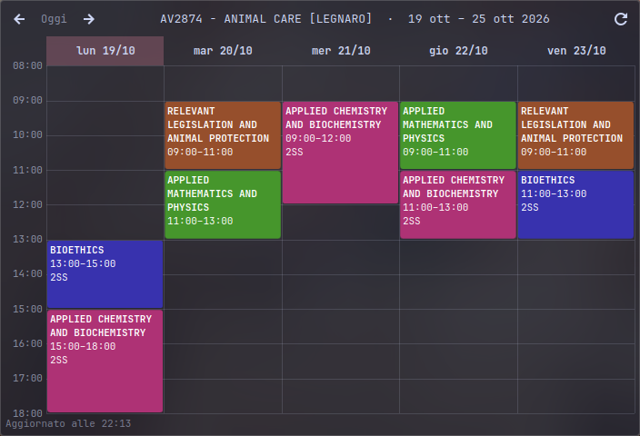

# UniPD Timetable

A KDE Plasma 6 widget that shows your **University of Padua (UniPD)** lesson timetable right on your desktop or panel, using the same data as the official *Agenda Studenti* / *OrariUniPD* app.



> **Unofficial project.** This widget is not affiliated with, endorsed by, or supported by the Università degli Studi di Padova. It reads publicly available timetable data from the university's servers.

## Features

- Weekly timetable view with lessons laid out by time of day
- Overlapping lessons shown side by side
- Pick your degree course (*corso di studio*) and teaching period from a searchable list
- Choose exactly which courses (*insegnamenti*) you follow, across different years
- One consistent color per subject
- Week navigation, with the current day and time highlighted
- Optional display of cancelled lessons
- Automatic refresh at a configurable interval (default: every 6 hours)
- Week navigation is local: data is downloaded once per refresh, not on every click

The widget interface is in Italian.

## Requirements

- KDE Plasma **6.0** or newer
- An internet connection

## Installation

### From a release

1. Download `unipd-timetable.plasmoid` from the [Releases](../../releases) page.
2. Install it:
   ```bash
   kpackagetool6 -t Plasma/Applet -i unipd-timetable.plasmoid
   ```
   or right-click the desktop/panel → **Add or Manage Widgets** → **Get New Widgets** → **Install Widget From Local File…**
3. Add **UniPD Timetable** to your desktop or panel.

### From source

```bash
git clone https://github.com/zac06/unipd-timetable.git
cd unipd-timetable
kpackagetool6 -t Plasma/Applet -i .
```

To update after pulling changes:

```bash
kpackagetool6 -t Plasma/Applet -u .
```

To uninstall:

```bash
kpackagetool6 -t Plasma/Applet -r org.unipd.timetable
```

## Configuration

Right-click the widget → **Configure UniPD Timetable…**

1. Start typing the name of your degree course (e.g. `informatica`) and select it from the suggestions.
2. Choose the teaching period (*Periodo*).
3. Tick the courses you attend.
4. Optionally adjust the refresh interval and whether cancelled lessons are shown.

## Development

Preview the widget without installing it:

```bash
plasmoidviewer -a .
```

Project layout:

```
.
├── metadata.json            # Plasmoid metadata
└── contents
    ├── config
    │   ├── config.qml       # Config page registration
    │   └── main.xml         # Settings schema and defaults
    └── ui
        ├── main.qml         # Widget UI and timetable rendering
        ├── configGeneral.qml# Settings page
        └── parse.js         # API endpoint and XML parser
```

Build a distributable package:

```bash
zip -r unipd-timetable.plasmoid metadata.json contents
```

## How it works

The widget queries the UniPD *Agenda Web* service for the list of degree courses and teachings, then downloads the semester timetable of each selected teaching and parses it locally. Nothing is sent anywhere except these requests to the university's servers, and no account or login is needed.

Because this relies on an undocumented endpoint, it may stop working if the university changes its service. If that happens, please open an issue.

## Contributing

Issues and pull requests are welcome.

## License

GPL-3.0-or-later. See [LICENSE](LICENSE).
